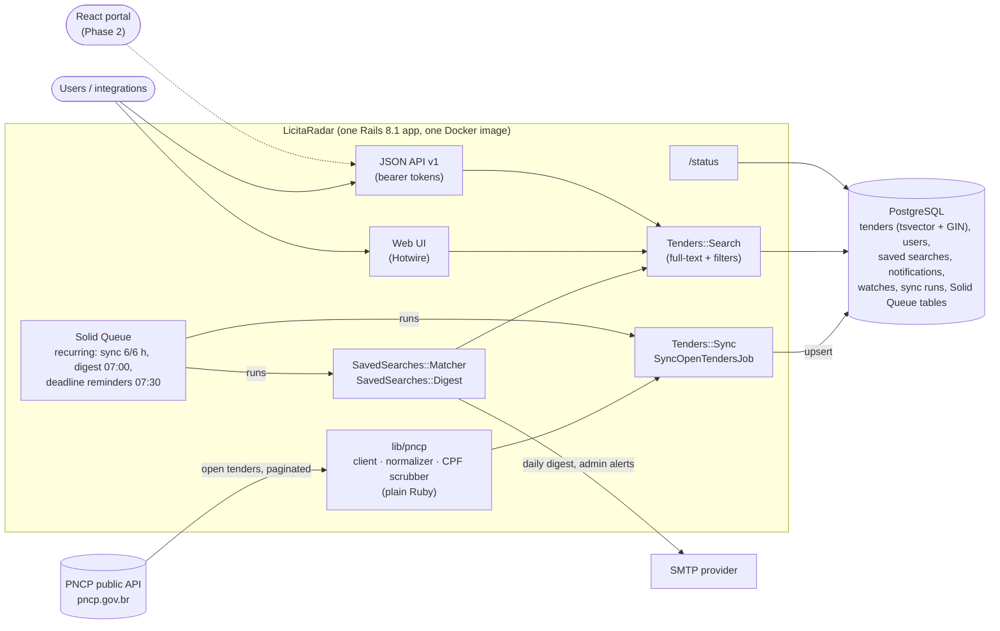

# LicitaRadar

**Open public tenders for your niche, without combing through government portals one by one.**

LicitaRadar watches Brazil's national public procurement portal — the
[PNCP (Portal Nacional de Contratações Públicas)](https://pncp.gov.br) — and turns its
raw open data into something a small business can actually use: a searchable list of
tenders that are **still open for proposals**, filtered for a niche (e.g. marketing,
events, IT services), plus daily e-mail alerts before the deadline.

> 🇧🇷 **Resumo:** o LicitaRadar coleta diariamente as licitações abertas no PNCP, faz busca
> em português (a API oficial ignora filtros de palavra-chave) e manda alertas por e-mail
> para empresas pequenas que querem vender para o governo sem pagar caro por isso.

## Who it is for

- Small and medium Brazilian companies (agencies, event producers, IT and service
  providers) that want to sell to the government but can't afford enterprise
  procurement-monitoring tools.
- Consultants who track tenders for several clients.

## Why

Since Law 14.133/2021, every public purchase in Brazil has to be published on the PNCP,
which exposes a free, open query API. In practice the API is hard to use directly:

- keyword filters are silently ignored — you get every tender, not the ones you asked for;
- results are split by modality and paginated, and the service is slow and flaky;
- dates come in Brasília local time without offsets, values are sometimes `0` (confidential);
- free-text fields occasionally contain personal data (CPF numbers).

LicitaRadar handles all of that once, so users only see relevant, clean opportunities.

## Features

- **Open tenders only.** Every 6 hours LicitaRadar pulls the tenders still open for
  proposals from the PNCP (competitive modalities: pregão, concorrência, dispensa, ...).
- **Search that works in Portuguese.** Keywords with or without accents, stemming
  ("eventos" finds "evento"), `"exact phrases"` and `-exclusions`, ranked by relevance;
  filters by state, modality, estimated value and "closes in N days".
- **Documents and items of each tender.** The tender page lists the edital, termo de
  referência and other files (linked to the PNCP) and the items with quantities and
  estimated values, fetched in the background the first time the page is opened; item
  descriptions become searchable too.
- **Niche presets.** One click for marketing & communication, events or IT
  (`config/niches.yml`).
- **Saved searches and a daily digest.** Save any search and get one e-mail every morning
  with what is new, most urgent deadlines first, with one-click unsubscribe.
- **Watchlist ("Minhas licitações").** Follow any tender with one click, keep private
  notes on it, get an e-mail 1, 3 or 7 days before the proposals deadline (again if the
  agency moves it) and subscribe to the deadlines from Google Agenda, Outlook or Apple
  Calendar through a secret `.ics` URL.
- **CSV export** of search results (up to 5,000 rows) and of the watchlist, ready for Excel
  in Portuguese (UTF-8 with BOM, `;`, decimal comma).
- **JSON API v1** with bearer tokens, for integrations and the upcoming React portal
  ([`docs/API.md`](docs/API.md)).
- **Built to run unattended.** Retries at three levels, an alert e-mail when the sync keeps
  failing, an admin status page (`/status`, also as JSON for uptime monitors) and a
  production Docker image smoke-tested in CI ([`docs/DEPLOY.md`](docs/DEPLOY.md)).
- **Privacy by default.** CPF numbers masked before storage, hashed passwords and API
  tokens, rate-limited login and API.

## Screenshots

> Screenshots will be added after the first public deploy. Until then, run the app locally
> with the fictional seed data (`bin/rails db:seed`) to see every page.

| Page | Path |
| --- | --- |
| Home (search box, niches, numbers) | `/` |
| Results with filters | `/tenders?niche=eventos` |
| Tender detail with deadline countdown | `/tenders/:id` |
| Saved searches | `/saved_searches` |
| Watched tenders, notes and calendar link | `/minhas-licitacoes` |
| Daily digest e-mail (preview) | `/rails/mailers/digest_mailer/daily` |
| Deadline reminder e-mail (preview) | `/rails/mailers/reminder_mailer/deadlines` |
| Admin status | `/status` |

## Architecture



## Status

✅ **Phase 1 (core product) done — v0.1.0, Nov 22, 2026.** Next: the React portal
(Phase 2). See [`ROADMAP.md`](ROADMAP.md), [`CHANGELOG.md`](CHANGELOG.md) and the sprint
log and report in [`docs/sprint/`](docs/sprint).

| Area | State |
| --- | --- |
| PNCP API client (pagination, retries, 204 handling) | ✅ done, tested |
| Record normalization (Brasília times, decimals, CNPJ, public URL) | ✅ done, tested |
| LGPD: CPF masking in free-text fields | ✅ done, tested |
| Persistence (`tenders` with Portuguese full-text column) + idempotent sync | ✅ done, tested |
| Sync retries, admin alert e-mail, status page | ✅ done, tested |
| Search (accent-insensitive, ranked) + niche presets + public UI | ✅ done, tested |
| Recurring schedule: sync every 6 h, digest at 07:00 (Solid Queue) | ✅ done, tested |
| Accounts (sign-up, login, password reset) + saved searches + match engine | ✅ done, tested |
| Daily e-mail alerts (one digest per user, unsubscribe links) | ✅ done, tested |
| Watchlist, private notes, deadline reminders, calendar feed, CSV export | ✅ done, tested |
| JSON API v1 with bearer tokens ([`docs/API.md`](docs/API.md)) | ✅ done, tested |
| Production Docker image + deploy guide ([`docs/DEPLOY.md`](docs/DEPLOY.md)) | ✅ done, smoke-tested in CI |
| React portal | 🗓️ planned (Phase 2) |

## Built with

- **Ruby 3.3 / Rails 8.1** (Hotwire, Propshaft, import maps — no Node build step)
- **PostgreSQL** (Portuguese full-text search)
- **Minitest** + WebMock, **RuboCop** (rails-omakase), **Brakeman**
- GitHub Actions CI

The PNCP integration lives in [`lib/pncp`](lib/pncp) as plain Ruby with **no Rails
dependency**, so it can be tested and reused on its own.

## Getting started

Requirements: Ruby 3.3.13, PostgreSQL 14+.

```bash
git clone https://github.com/Dhonatan/licitaradar.git
cd licitaradar
cp .env.example .env        # adjust DB credentials if needed
bin/setup                   # installs gems and prepares the database
bin/rails server            # http://localhost:3000
```

Try the PNCP client against the real API (no database needed):

```bash
bin/pncp-probe          # open "Pregão Eletrônico" tenders
bin/pncp-probe 8 PE     # open "Dispensa" tenders in Pernambuco
```

No access to the PNCP? Load 30 fictional tenders and open http://localhost:3000/tenders:

```bash
bin/rails db:seed
```

Load open tenders into your local database:

```bash
bin/rails pncp:sync                  # every competitive modality
MODALITIES=6,8 bin/rails pncp:sync   # only Pregão Eletrônico and Dispensa
```

Run the background jobs and the recurring schedule (`config/recurring.yml`: sync every
6 hours, daily digest at 07:00 Brasília time):

```bash
bin/jobs
```

Preview the daily digest e-mail at http://localhost:3000/rails/mailers/digest_mailer/daily.

The JSON API (`/api/v1`) is documented in [`docs/API.md`](docs/API.md); create a token
while signed in at http://localhost:3000/api_tokens.

## Deploying

One Docker image, one PostgreSQL database, an SMTP provider. Step-by-step for Render,
Fly.io, Kamal or any Docker host, the environment variables and the post-deploy checklist
are in [`docs/DEPLOY.md`](docs/DEPLOY.md).

```bash
docker build -t licitaradar .
docker run -p 3000:3000 -e DATABASE_URL=... -e SECRET_KEY_BASE=... -e APP_HOST=... \
  -e SOLID_QUEUE_IN_PUMA=1 licitaradar
```

## Running tests

```bash
bin/test-lib            # fast, framework-independent tests (plain Ruby + Minitest)
bin/rails test          # full suite (needs PostgreSQL)
bin/rubocop             # style
bin/brakeman            # security scan
```

## Project layout

```
lib/pncp/            PNCP API clients (consultation + integration), normalizers, PII scrubber (no Rails)
app/                 Rails app (models, jobs, controllers, views)
app/services/        Tenders::Sync (PNCP → database), Tenders::FetchDetails (documents and
                     items of one tender) and Tenders::Search (query object)
app/services/saved_searches/  SavedSearches::Matcher (what a saved search should alert about)
                     and SavedSearches::Digest (one user's daily e-mail)
app/services/watches/  Watches::DeadlineReminder (one user's reminder e-mail) and
                     Watches::Calendar (iCalendar feed); Tenders::CsvExport (CSV downloads)
app/controllers/api/ JSON API v1 (serializers in app/serializers/api/)
config/recurring.yml recurring jobs (Solid Queue)
config/locales/      Portuguese UI messages (English fallback)
config/niches.yml    niche presets (keywords per line of business)
public/              static error pages (404, 422, 500, ...) in Portuguese
test/lib/            tests for lib/ — run with bin/test-lib
test/                Rails tests
docs/                API, deploy guide, development guide, performance notes
docs/sprint/         day-by-day plan, log and final report of the bootstrap sprint
Dockerfile           production image (bin/docker-entrypoint prepares the database)
```

## Data & privacy

- Only **public** procurement data from the PNCP is collected (open government data,
  Lei 14.133/2021, art. 174).
- CPF numbers found in free-text fields are masked before storage.
- Account passwords are stored only as bcrypt hashes; login, sign-up and password reset
  requests are rate limited.
- API tokens are stored only as SHA-256 hashes and shown once; every digest e-mail has
  unsubscribe links (and one-click `List-Unsubscribe` headers) that work without a login.
- The repository contains **only fictional sample data** (see `test/fixtures`).

## Contributing

Issues and pull requests are welcome. Please run `bin/test-lib`, `bin/rails test` and
`bin/rubocop` before opening a PR.

## License

[MIT](LICENSE) © 2026 Dhonatan
